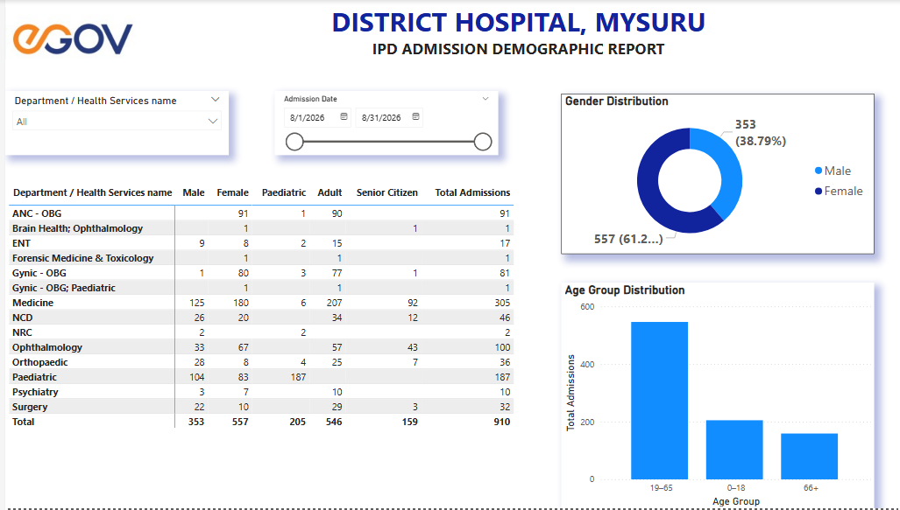

# 🏥 Hospital IPD Demographic Dashboard

**Power BI | Healthcare Analytics | Data Visualization**

## 📊 Project Overview

The Hospital IPD Demographic Dashboard is an interactive healthcare analytics solution developed using Microsoft Power BI for District Hospital, Mysuru.

The dashboard provides insights into Inpatient Department (IPD) admissions, helping monitor patient demographics, department-wise admissions, gender distribution, and age-group distribution.

## 🎯 Key Features

- **Department-wise Admissions:** Displays IPD admission counts across different hospital departments.
- **Gender Distribution:** Visualizes male and female patient admissions.
- **Age Group Analysis:** Categorizes patients into three groups:
  - 0–18 years
  - 19–65 years
  - 66+ years
- **Date Range Filter:** Analyze admissions for a selected date range.
- **Department Filter:** Filter admission data by department.
- **Demographic Summary:** Displays male, female, pediatric, adult, and senior citizen admission counts.

## 📈 Dashboard Preview

## 🛠️ Tools & Technologies

- Microsoft Power BI
- Power Query
- DAX
- Data Visualization
- Healthcare Analytics

## 📂 Project Files

| File | Description |
|---|---|
| `Report based on age and dept.pbix` | Power BI dashboard source file |
| `hospital-ipd-demographic-dashboard.png` | Dashboard screenshot |

## 💡 Project Objective

To provide a clear and interactive view of hospital IPD admission patterns and patient demographics, supporting healthcare monitoring and data-driven decision-making.

---

**Project Category:** Healthcare Analytics  
**Developed Using:** Microsoft Power BI
